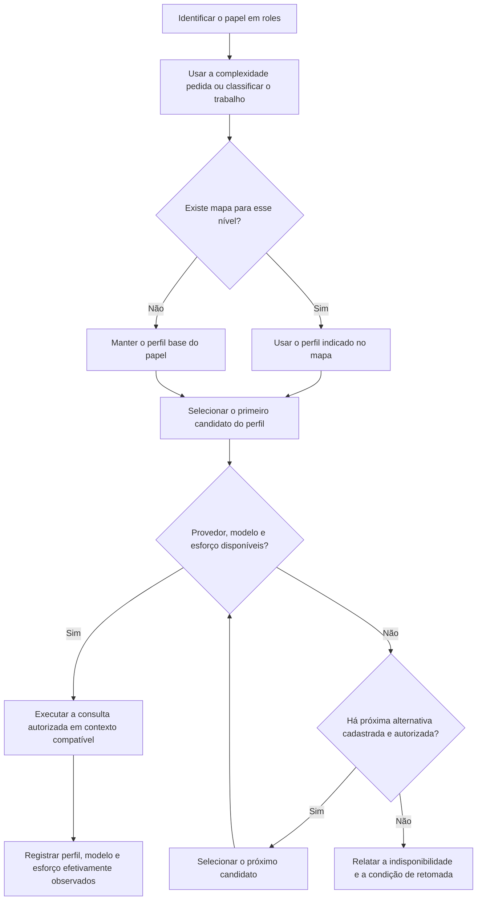

# Como papéis e perfis escolhem os modelos

A responsabilidade define **quem faz o quê**. O perfil indica **quais modelos tentar**.
A complexidade pode mudar o perfil quando existe um vínculo explícito na configuração.

Este guia explica a política atual deste repositório, em
[`.agents/models.toml`](../.agents/models.toml), versão 2. Ela orienta novas consultas ou
delegações autorizadas; não inicia agentes nem troca o modelo da conversa aberta.

## O que cada nome significa

| Conceito | Exemplo | O que representa |
| --- | --- | --- |
| Skill | `specify` | O procedimento a seguir para uma situação. |
| Papel (`role`) | `planner` | A responsabilidade de quem faz o trabalho. |
| Complexidade | `simple`, `default`, `hard` | A classificação do trabalho, pelo escopo e pela consequência do erro. |
| Perfil (`profile`) | `hard` | Uma lista ordenada de candidatos configurados no projeto. |
| Modelo | `claude-opus-5-5` | O modelo que a ferramenta é solicitada a executar. |
| Esforço (`effort`) | `medium`, `high` | Uma configuração de raciocínio aceita pela ferramenta. |

Por exemplo: **`specify` orienta o `planner`, que usa o perfil `hard`; aqui, o primeiro
candidato desse perfil é Claude Opus 5.5 com esforço `high`.**

`hard` e `high` são coisas diferentes. O primeiro pode classificar o trabalho ou nomear um
perfil; o segundo é um valor de esforço. Classificar uma tarefa como `hard` só muda sua
seleção se o papel tiver um mapa para esse nível.

## Quem faz o quê

| Papel | Responsabilidade | Perfil base aqui | A complexidade muda o perfil? |
| --- | --- | --- | --- |
| `orchestrator` | Coordenar o trabalho e integrar os resultados. | `orchestrator` | Não há mapa neste projeto. |
| `planner` | Especificar comportamentos e planejar a entrega, sem implementar. | `hard` | Não. Aqui, até planejamento pequeno usa `hard`. |
| `implementer` | Implementar uma parte delimitada e apresentar provas. | `default` | Sim: `simple` → `simple`; `hard` → `hard`. |
| `reviewer` | Analisar um diff fixado e relatar achados. | `default` | Sim: `simple` → `simple`; `hard` → `hard`. |
| `evaluator` | Conferir os critérios de aceite independentemente da implementação. | `evaluator` | Não aceita mapa. |
| `representative` | Escolher entre alternativas dentro de uma autonomia autorizada. | `representative` | Não aceita mapa. |
| `council` | Reunir pareceres independentes sobre uma decisão ou proposta. | `evaluator` | Não aceita mapa. |

Esses sete nomes são responsabilidades na política. A coleção distribui arquivos de papel
próprios para [planner](../.agents/roles/planner.md),
[evaluator](../.agents/roles/evaluator.md) e
[representative](../.agents/roles/representative.md). Uma entrada em `roles` não cria,
por si só, um tipo de agente na ferramenta.

## Fluxograma da seleção

O caminho abaixo vale quando o pedido não fixa um modelo. Uma escolha explícita do usuário
prevalece; se ele fixar apenas o esforço, esse valor é preservado na seleção.

`default` usa sempre o perfil base. Sem motivo concreto para outra classificação, esse é
o nível adotado. Se o nível for conhecido, mas não houver mapa, o perfil base é mantido.
Nomes de papel ou perfil inexistentes e níveis desconhecidos são erros de configuração ou entrada.

Uma resposta ruim não significa que o modelo está indisponível: o caminho é conferir,
corrigir ou diagnosticar o resultado. As alternativas não são uma escala automática de qualidade.
Se o usuário exigiu um modelo e ele não pode executar, outra opção precisa estar autorizada.

## Alguns percursos na configuração atual

| Situação | Papel e complexidade | Perfil escolhido | Primeiro candidato |
| --- | --- | --- | --- |
| Renomear uma variável em um trecho delimitado. | `implementer` + `simple` | `simple` | GPT-6 Luna, `medium`. |
| Implementar um relatório comum. | `implementer` + `default` | `default` | GPT-6.1 Sol, `medium`. |
| Revisar um diff com mudanças delicadas de arquitetura. | `reviewer` + `hard` | `hard` | Claude Opus 5.5, `high`. |
| Planejar uma mudança pequena. | `planner` + `simple` | `hard` | Claude Opus 5.5, `high`. |
| Conferir o aceite de uma entrega simples. | `evaluator` + `simple` | `evaluator` | Claude Opus 5.5, `high`. |
| Resolver uma escolha autorizada durante um goal. | `representative` + `default` | `representative` | Claude Opus 5.5, `high`. |

São preferências configuradas, não provas de disponibilidade ou de execução. A lista completa
de candidatos e alternativas está em [MODELS.md](MODELS.md#configuração-pessoal).

## Por que o representante tem um perfil separado?

`hard`, `representative`, `evaluator` e `orchestrator` têm hoje os mesmos candidatos, mas são
listas distintas. Assim, trocar o modelo do trabalho `hard` não muda automaticamente o
representante nem o avaliador. Já `council` usa o perfil `evaluator`: alterar essa lista afeta ambos.

O representante recebe opções, evidências e preferências e devolve uma decisão em leitura.
Quem coordena registra a autoria da decisão e continua o trabalho permitido. Ele não amplia
o objetivo nem assume escolhas reservadas ao usuário; uma espera pedida por `propose`
continua valendo, salvo delegação explícita daquela aprovação.

Para alterar a política ou entender os formatos, consulte [MODELS.md](MODELS.md).
Para escolher uma skill pelo problema que quer resolver, veja os [exemplos de uso](EXAMPLES.md).
